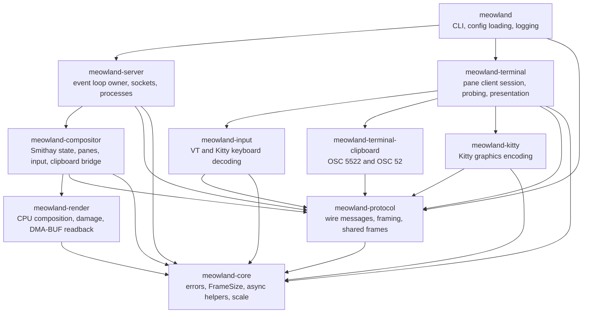
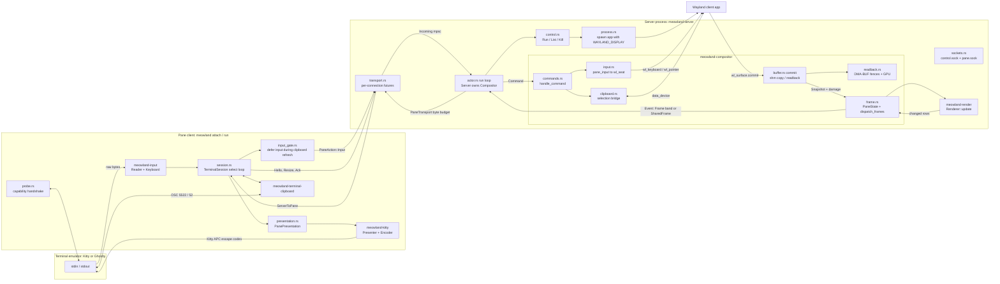
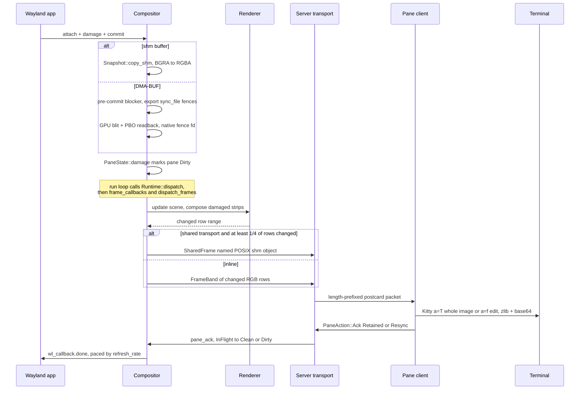

A Wayland compositor that runs apps in terminal panes.

## Architecture

Meowland runs as two kinds of process:

- **Server** (`meowland server`): a headless Wayland compositor. It runs on one thread
  with a single `calloop` loop.
- **Pane clients** (`meowland run` / `meowland attach`): one per terminal. Each pane
  client sends terminal input to the server and draws the frames it gets back using the
  Kitty graphics protocol.

### Crate dependencies

### Runtime flow

### Frame lifecycle

Only one frame per pane is in flight at a time. The next frame is composed after the
pane acknowledges the current one, which gives end-to-end backpressure.
